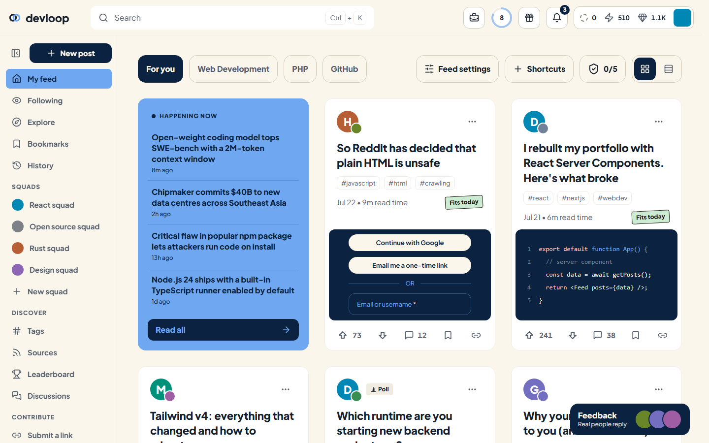
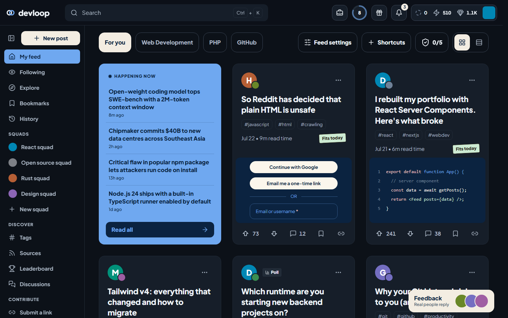
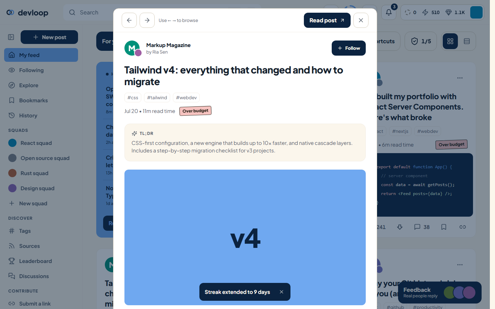
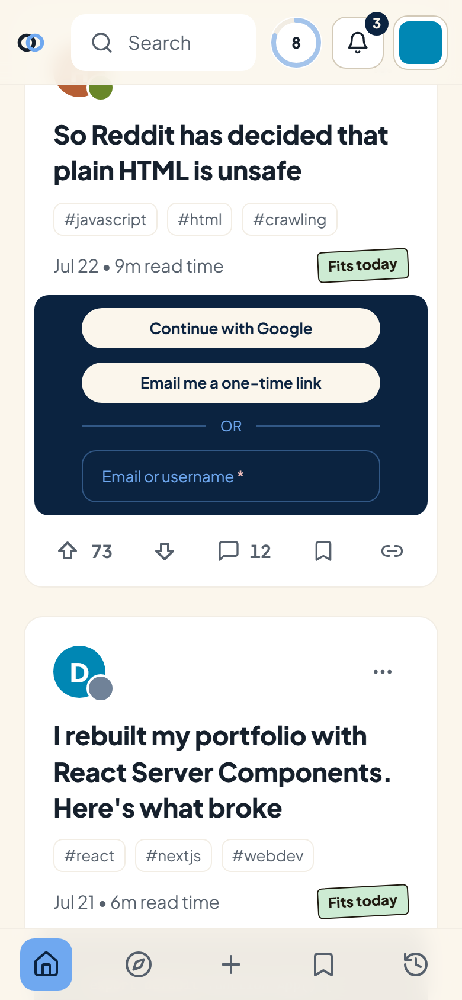

# devloop

A developer news feed built with **React** and **Tailwind CSS** for the USM CSS recruitment task. The layout and feature set are modelled on [daily.dev](https://daily.dev); the colours, type and spacing come from my own design system.

**Live demo:** [devloop.abrahamtan.com](https://devloop.abrahamtan.com)



> [!IMPORTANT]
> **This project was built with AI.** Most of the code was written by an AI coding agent (Claude, using Claude Code). I used AI for this because I'm busy with a hackathon project right now and couldn't give this task the hours it deserves by hand.
>
> My part was directing the work: choosing the reference (daily.dev), the features and the design system, reviewing the output in the browser at different screen sizes, and asking for changes. A second AI review pass checked the code against the task's three criteria, and its findings were fixed before submission. Everything is covered by end-to-end tests (see [Testing](#testing)).

## Screenshots

| Dark theme | Post view | Phone |
| --- | --- | --- |
|  |  |  |

## Features

- **Feeds and views:** My feed, Following, Explore (Popular, Most upvoted, Best discussions, Latest), Bookmarks, History and Discussions.
- **Tabs from your tags:** the tabs above the feed are the tags you follow. Manage them in Feed settings, or follow one straight from search.
- **Card types:** article, video, collection, poll (you can vote) and promoted. Each card has a ⋯ menu with share, bookmark, follow source, "Not interested" (with Undo) and report.
- **Post view:** TL;DR summary, follow button and a comment thread. Use ← → to move through the feed you opened it from. Every post has a shareable link (`/?post=3`).
- **Search palette:** Ctrl/Cmd + K or `/`. Searches titles, summaries and tags word by word, with recent searches and quick jumps. Fully keyboard-driven.
- **Reading budget:** see [below](#signature-feature-the-reading-budget).
- **Also included:** a reading streak, notifications, a profile menu, a get-started checklist that ticks itself off, a shortcuts row, grid and list layouts, infinite scroll with skeleton loaders, and toasts with Undo.
- **Remembers your setup:** theme, layout, sidebar, followed tags, bookmarks, history, shortcuts and budget are saved in `localStorage`.

### Signature feature: the reading budget

My design system comes from a spending-tracker app whose main number is "safe to spend today". devloop applies the same idea to time.

You set a daily reading budget in Feed settings. Every post then gets a tilted sticker showing how it fits what's left of your day: **Fits today**, **Tight fit** or **Over budget**.

Opening a post spends its minutes. The streak popover shows **min left today** with a status bar.

## Design system

Everything visual comes from my **Finance Tracker** design system. Only its colours, type and spacing were used, not its components.

**Colours:**
- Cream `bg` and white `surface`.
- Navy `primary` buttons.
- One cornflower `brand` moment per screen: the Happening Now card and the active nav item.
- Category colours fill source logos and avatars.
- Sticker colours are used only for reading-budget status.

**Type:** Plus Jakarta Sans with the system's scale (`headline`, `title`, `button`, `body`, `label`, `caption`, `overline`) and weights 400/500/700/800.

**Spacing:** a 4px scale. Margins, padding and gaps only use steps 1, 2, 3, 4, 5, 6, 8 and 10.

**What's left out:** no gradients, no shadows and no emoji.

**Dark mode:** a real theme, defined as a second set of the same tokens.

**Where it lives:**
- Theme tokens are CSS variables in [`src/index.css`](src/index.css).
- Static colours, the type scale and layout sizes are in [`tailwind.config.js`](tailwind.config.js).

## How it meets the criteria

### Code quality

- **Small components:** focused components grouped by area: `header/`, `toolbar/`, `cards/`.
- **Shared building blocks:** `Button`, `TextField`, `Sticker` and `TagPill` live in `ui.jsx`.
- **State:**
  - All state lives in one provider in `store.jsx`.
  - Actions are created once and sit in their own context, so components that only call actions don't re-render on state changes.
  - Values that persist go through a guarded `usePersistentState` hook.
- **Dialogs:** they stack properly.
  - Only the top one reacts to Escape.
  - Focus is trapped inside and returned to whatever opened it.
  - Page scroll comes back when the last one closes.
- **Lint:** ESLint (`eslint-plugin-react-hooks`) runs clean.
- **Tailwind:** every class comes from the design-system tokens; there are no hard-coded hex colours in components.

### Responsiveness

- **Phones:**
  - Single-column feed and a bottom tab bar.
  - Header popovers span the screen.
  - Tabs scroll sideways.
  - Every action stays reachable; labels collapse to icons.
  - Tap targets are at least 44px, and there's safe-area padding for notched phones.
- **Tablets:** the sidebar starts collapsed to a 60px rail, so the feed keeps two columns.
- **Laptops and wide screens:** an expandable sidebar and an auto-filling card grid.

### Design creativity

- **Reading budget:** tilted stickers for how each post fits today's reading time.
- **Streak:** a ring in the header with a weekly calendar.
- **Thumbnails:** drawn in CSS, so the repo needs no image assets.
- **Happening Now:** a single cornflower "brand" card.
- **Small touches:** an upvote pop animation and a pulsing live dot.

## Getting started

Requires Node 18 or later.

```bash
npm install
npm run dev         # http://localhost:5173
npm run build       # production build in dist/
npm run preview     # serve the production build
npm run lint        # ESLint
npm run test:e2e    # Playwright end-to-end tests
```

The first time you run the tests, install the browser with `npx playwright install chromium`. To test a deployed copy instead of a local build, set `BASE_URL`, for example `BASE_URL=https://devloop.abrahamtan.com npm run test:e2e`.

## Testing

[`e2e/feed.spec.js`](e2e/feed.spec.js) holds 21 Playwright tests. They run against the production build on two devices, desktop Chrome at 1440px and a Pixel 7. Any console error fails a test.

They cover:
- Layout and overflow.
- The bottom nav vs. the sidebar.
- Popovers staying on screen.
- Infinite scroll.
- Opening, commenting on and browsing posts.
- Deep links.
- Stacked dialogs and Escape.
- Search.
- Voting, bookmarks and polls.
- Undo.
- Reading-budget stickers.
- Feed settings.
- Keyboard tabs.
- Layout and theme that persist after a reload.

## Project structure

```
src/
├── App.jsx                   # Page shell, keyboard shortcut, dialog outlet
├── store.jsx                 # State + stable actions (two contexts), deep links
├── hooks.js                  # usePersistentState, useMediaQuery, helpers
├── budget.js                 # Reading-budget rules
├── data.js                   # Mock posts, sources, tags, notifications
├── index.css                 # Theme tokens (light + dark), base styles
└── components/
    ├── header/               # StreakPopover, NotificationsPopover, ProfileMenu
    ├── toolbar/              # FeedToolbar, FeedTabs, Checklist, LayoutToggle
    ├── cards/                # PostCard, PollCard, AdCard, CardMenu, PostThumb, shared parts
    ├── Feed.jsx              # Filtering, sorting, infinite scroll, empty states
    ├── PostModal.jsx         # Post view with discussion
    ├── CommandPalette.jsx    # Search
    ├── FeedSettings.jsx      # Tags, layout and reading budget
    ├── Sidebar.jsx           # Collapsible sidebar + phone tab bar
    ├── Modal.jsx, Popover.jsx, ui.jsx, BudgetBar.jsx, HappeningNow.jsx, ...
```

All content is mock data in `src/data.js`; there is no backend. Squads, Leaderboard, Jobs and Games aren't built yet and show a "coming soon" message.

## Credits

- Layout and feature ideas: [daily.dev](https://daily.dev). This is an independent study project, not affiliated with them.
- Icons: [Lucide](https://lucide.dev).
- Font: [Plus Jakarta Sans](https://fonts.google.com/specimen/Plus+Jakarta+Sans).
- Code: written with Claude (Anthropic) through Claude Code, directed and reviewed by me.
